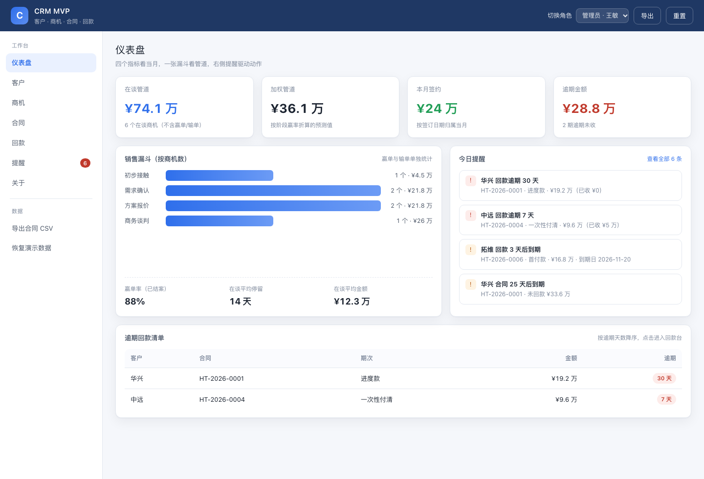
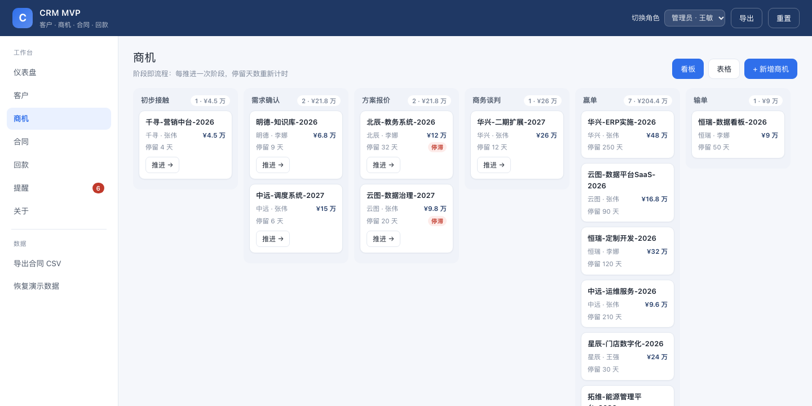
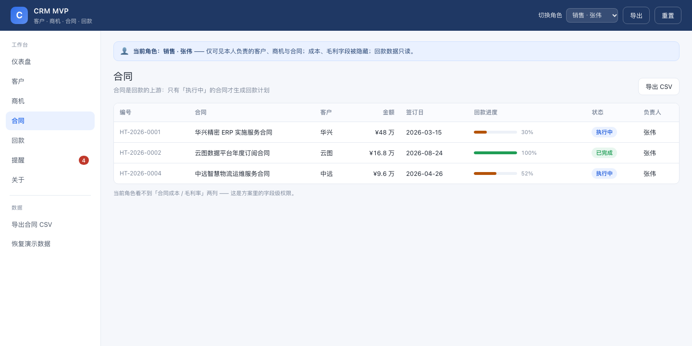

# CRM MVP · 客户-商机-合同-回款

一个能点开就用的销售运营系统最小可用版本：**客户 → 商机 → 合同 → 回款计划 → 回款记录** 主链路 + 仪表盘 + 权限演示。

纯静态，零依赖，一个 `index.html` 加一个 `app.js` 就能跑，数据存在浏览器 localStorage。

> 它是《飞书多维表格销售运营管理信息系统 建设方案》的可运行版本：方案里用多维表格的表、视图、自动化、高级权限实现的东西，这里用一个网页按同样的业务规则跑一遍。



## 在线演示

GitHub Pages：**https://sakuralovesmile.github.io/crm-mvp/**

本地打开也行，见下面「快速开始」。

## 有什么

| 模块 | 内容 |
|---|---|
| 客户 | 列表 + 搜索 + 新增 + 详情（关联商机 / 合同 / 回款汇总） |
| 商机 | 看板（按阶段拖不动，用「推进 →」）与表格双视图，赢率、加权金额、停留天数实时算 |
| 合同 | 台账 + 回款完成率进度条 + 详情里的回款计划与回款记录 |
| 回款 | 计划台账，按「逾期 / 7 天内到期 / 已回款」筛选，登记回款后状态自动更新 |
| 仪表盘 | 在谈管道、加权管道、本月签约、逾期金额；阶段漏斗；赢单率与平均停留 |
| 提醒 | 逾期催收、到期前 7 天、商机停滞 15 天、合同 30 天内到期 —— 对应方案里的 4 条自动化 |
| 权限 | 4 个角色切换：记录范围（本人 / 全部）+ 字段隐藏（成本、毛利率）+ 操作权限 |



## 快速开始

**方式一：直接双击**
```bash
open index.html          # macOS
```
不需要安装任何东西，也不需要起服务。

**方式二：起个静态服务**（推荐，避免个别浏览器对 file:// 的限制）
```bash
python3 -m http.server 8080
# 打开 http://localhost:8080
```

**方式三：部署到 GitHub Pages**
仓库 Settings → Pages → Source 选 `Deploy from a branch` → 分支 `main`、目录 `/` → 保存，一分钟后就有一个公网地址。

首次打开会自动灌入一套演示数据（10 家客户、14 个商机、7 份合同、15 期回款计划），右上角「重置」可以随时恢复。

## 权限演示

右上角切换角色，页面会立刻变化：

| 角色 | 记录范围 | 字段 | 能做什么 |
|---|---|---|---|
| 管理员 · 王敏 | 全部 | 全部 | 全部读写 |
| 销售 · 张伟 | 仅本人负责的客户/商机/合同 | 看不到成本、毛利率 | 建客户、建商机、推进阶段（回款只读） |
| 财务 · 李静 | 全部 | 全部 | 改合同、登记回款（商机只读） |
| 只读 · 访客 | 全部 | 看不到成本、毛利率 | 什么都改不了 |

也可以用链接直接进某个角色，方便演示：

```
index.html?role=sales#/contracts
```



## 数据模型

5 张表，字段与方案里的多维表格一一对应：

| 表 | 关键字段 | 与谁关联 |
|---|---|---|
| 客户 | 编号、简称、行业、区域、等级、来源、负责人、状态 | 被商机、合同引用 |
| 商机 | 编号、客户、阶段、金额、赢率、加权金额、预计成交日、停留天数 | 关联客户 |
| 合同 | 编号、客户、金额、成本、签订日、服务期、付款方式、状态 | 关联客户、商机 |
| 回款计划 | 期次、计划回款日、计划金额、已收、状态、逾期天数 | 关联合同 |
| 回款记录 | 金额、日期、方式、核销状态 | 关联合同、回款计划 |

**不存派生值**：回款状态、逾期天数、加权金额、回款完成率都是每次渲染时算出来的，所以改一条回款记录，所有相关页面的数字立刻一致 —— 这也是方案里「派生数据一律自动计算」那条原则。

## 项目结构

```
crm-mvp/
├── index.html                  # 应用外壳
├── assets/
│   ├── app.js                  # 全部逻辑：数据层、计算、权限、渲染、交互
│   └── style.css               # 样式
├── docs/
│   ├── 建设方案.docx            # 完整设计方案（9 表 / 139 字段 / 14 自动化）
│   ├── 实施配置手册.xlsx         # 逐字段搭建清单
│   ├── 系统架构与数据模型.png
│   └── screenshots/            # README 用的截图
├── LICENSE
└── README.md
```

`app.js` 里数据层只有三个函数（`load` / `save` / `seed`），接后端时只需要把这三个换成 API 调用，其余不动。

## 已知边界

这是 **MVP**，故意不做的事：

- 没有后端与登录，数据只在本机浏览器；换设备就看不到
- 没有导入导出 Excel（只有合同 CSV 导出）
- 看板不能拖拽，用按钮推进阶段
- 提醒是打开页面时计算的，不是真的定时任务
- 没有多人协作、审批流、附件

下一步（按优先级）：接 SQLite + REST API → 飞书扫码登录与操作日志 → Excel 导入 → 真正的定时提醒。

## 配套文档

仓库 `docs/` 下是完整方案，和这个 MVP 是同一套业务模型：

- [建设方案](docs/飞书多维表格销售运营管理系统_建设方案.docx)：总体架构、9 张表的 139 个字段、5 个表单、29 个视图、4 块仪表盘、14 条自动化、7 个角色的权限矩阵、6 周实施计划
- [实施配置手册](docs/飞书多维表格销售运营管理系统_实施配置手册.xlsx)：20 个工作表，逐字段可勾选的搭建清单
- [系统架构与数据模型](docs/系统架构与数据模型.png)

## License

MIT © 2026 SakuraLoveSmile
